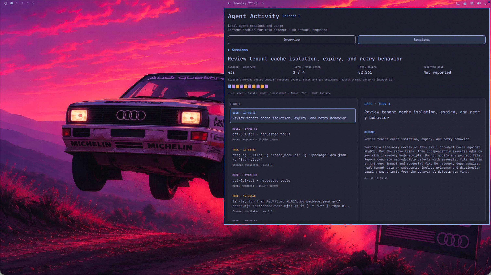

# Agent Activity for Omarchy

See your coding agent's usage and revisit its work, right from the Omarchy bar.
Powered by [LoongSuite Pilot](https://github.com/alibaba/loongsuite-pilot).

## See your usage

Switch between **Today**, **7 days**, and **30 days** to explore token usage,
cache reuse, daily trends, and the models you use.


## Follow a session

Browse your sessions, see their duration, turns, and token usage, then open one
to follow the conversation and inspect tool results. Costs appear when reported
by the source. Press **Backspace** or **Esc** to return to the session list.



*Screenshots show a demo dataset with conversation content enabled.*

## Install

Requires the Omarchy Quattro desktop, Python 3, Git, `curl`, `tar`, and a running
systemd user session. The panel reads LoongSuite Pilot 1.13.0 records for
supported agents such as Claude Code and Codex.

Open a terminal in Omarchy and run:

```sh
omarchy plugin add https://github.com/loongsuite/omarchy-agent-activity.git --enable
```

1. Click the **chart icon** in the top bar.
2. Open **Setup** and select **Review setup**.
3. Choose **Install & set up Pilot**, or **Connect existing Pilot** if a
   compatible installation is already available. A fresh install configures
   the supported agents Pilot detects. Keep the desktop running until setup
   completes.
4. Use a configured agent, then open **Overview** or **Sessions** and click
   **Refresh** to see the recorded activity.

## Uninstall

```sh
omarchy plugin remove io.github.loongsuite.pilot
```

This removes the Agent Activity widget. Pilot and its local records are managed
separately. See the [Pilot repository](https://github.com/alibaba/loongsuite-pilot)
if you also want to uninstall Pilot.

## Your data

The panel reads local records. New installations disable message-content
capture and remote export by default; existing Pilot settings are preserved.
Conversation details require content collection and display to be enabled.
These settings do not delete transcripts already stored by your coding agent.

Usage reflects available local records, not your account quota or billing total.

## License

[Apache License 2.0](LICENSE). See [NOTICE](NOTICE) and
[THIRD_PARTY_NOTICES](THIRD_PARTY_NOTICES) for third-party attribution.
LoongSuite Pilot is installed separately and retains its own license.
